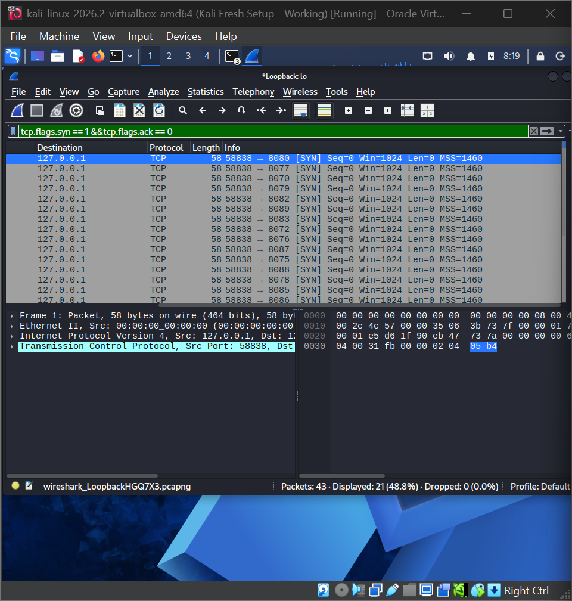
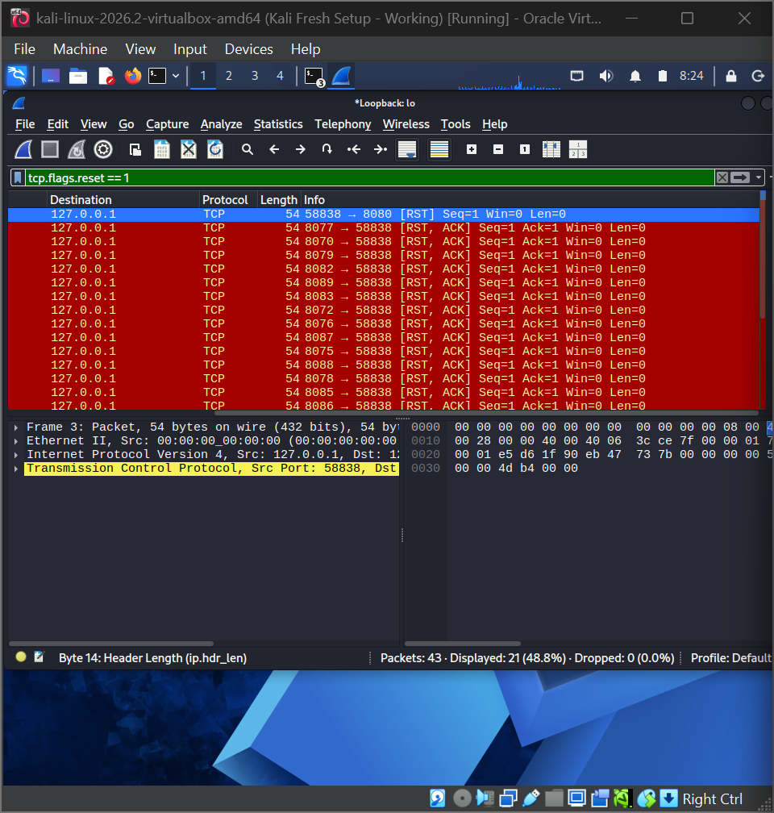
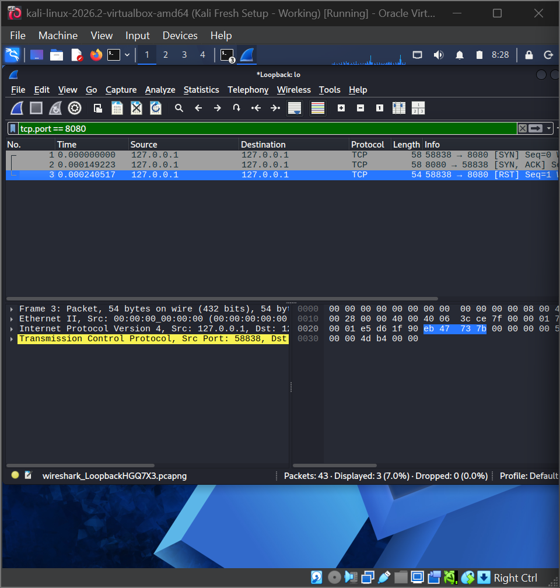
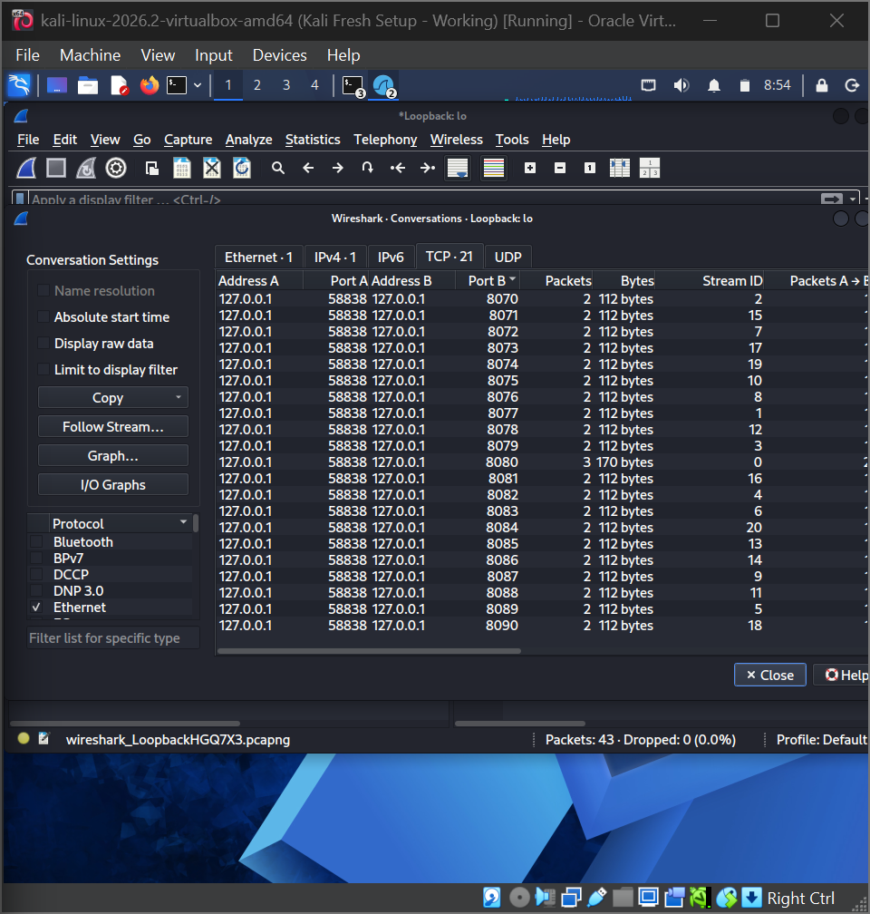

# Wireshark Lab: What a Port Scan Looks Like in Packets

**Part of my 90-day cybersecurity challenge** | Week 4 (27 Oct - 2 Nov 2026) | Lane: Blue team / DFIR

In my first Wireshark lab I looked at normal traffic. Here I did the opposite: I ran an nmap SYN scan against my own machine while capturing it, then analysed the packets the way a defender would. The goal was to learn what a port scan looks like on the wire, so I can recognise one in a firewall log or a SIEM.

---

## Contents

1. [Objective and scope](#1-objective-and-scope)
2. [Environment](#2-environment)
3. [Method](#3-method)
4. [Findings](#4-findings)
5. [Scan vs normal connection](#5-scan-vs-normal-connection)
6. [Security analysis](#6-security-analysis)
7. [Limitations](#7-limitations)
8. [Next steps](#8-next-steps)
9. [Resources](#9-resources)

---

## 1. Objective and scope

**Objective:** capture a port scan and identify, in the packets, how a scanner finds open and closed ports.

**Scope and ethics:**
- I scanned only my own virtual machine, over the loopback interface (`127.0.0.1`). No other host or network was touched.
- Port scanning other people's systems without permission is illegal, so I kept the whole lab inside my own machine.
- I have not published the capture file. Only screenshots are included here.

---

## 2. Environment

| Item | Detail |
|------|--------|
| Machine | Kali Linux in VirtualBox |
| Target | `127.0.0.1` (the VM itself) |
| Open service | A test web server I started: `python3 -m http.server 8080 --bind 127.0.0.1` |
| Scanner | nmap |
| Capture tool | Wireshark on the loopback interface (`lo`) |
| Capture size | 43 packets |

---

## 3. Method

1. Started the test web server on port 8080, so exactly one port in the scan range would be open.
2. Started a Wireshark capture on `Loopback: lo`.
3. Ran a SYN scan over 21 ports:

```
sudo nmap -sS -p 8070-8090 127.0.0.1
```

4. Stopped the capture and used display filters:

| Filter | Purpose |
|--------|---------|
| `tcp.flags.syn == 1 && tcp.flags.ack == 0` | Show only the opening SYN packets (the probes) |
| `tcp.flags.reset == 1` | Show the resets |
| `tcp.port == 8080` | Show the one open port |

I also used **Statistics, then Conversations, then the TCP tab** to summarise every connection attempt in one table.

---

## 4. Findings

### 4.1 The probes: 21 SYN packets



- The filter showed **21 of the 43 packets**, one for each port in the range 8070 to 8090.
- Every probe used the **same source port (58838)** and a different destination port. A normal program such as `curl` uses a new source port for each connection and talks to one service at a time, so one source port hitting many destination ports is a strong scan signal.
- The destination ports are **not in numerical order** (8080, 8077, 8070, 8079, and so on). nmap randomises the order by default.
- Each probe is a bare SYN: `Len=0`, `Win=1024`, `MSS=1460`, 58 bytes on the wire. There is no data in any of them. These details can help an analyst recognise a particular scanning tool.

### 4.2 The answers: closed ports refuse



The reset filter showed **21 packets**:

- **20 [RST, ACK] packets**, one from each **closed** port. The rows are red in Wireshark. Each is 54 bytes with `Ack=1` and `Win=0`. A closed port answers a SYN with a reset, meaning nothing is listening.
- **1 plain [RST]**, sent by nmap itself to port 8080 (explained next).

### 4.3 The open port: a half-open handshake



| Packet | Time | What happened |
|--------|------|---------------|
| 1 | 0.000000 s | **[SYN]**: nmap probes port 8080 |
| 2 | 0.000149 s | **[SYN, ACK]**: the web server answers that it is listening |
| 3 | 0.000241 s | **[RST]**: nmap hangs up instead of sending the final ACK |

nmap only wants to know whether the port is open. As soon as it sees the SYN-ACK, it knows, so it resets the connection. The three-way handshake never completes, which is why a SYN scan is called **half-open** (or "stealth") scanning.

### 4.4 The whole scan in one table



The TCP tab of the Conversations window lists **21 conversations**, all between `127.0.0.1:58838` and a different destination port:

| Group | Conversations | Packets each | Bytes each |
|-------|---------------|--------------|------------|
| Closed ports (8070 to 8090 except 8080) | 20 | 2 (SYN, RST-ACK) | 112 |
| Open port 8080 | 1 | 3 (SYN, SYN-ACK, RST) | 170 |

The totals match the capture: 20 x 2 + 3 = **43 packets**, and 20 x 112 + 170 = **2,410 bytes**. The Ethernet and IPv4 tabs each show a single conversation, because all of the traffic is between my machine and itself. The MAC addresses on loopback are all zeros, which is normal for traffic that never leaves the machine.

How the 43 packets break down:

| Packets | Count |
|---------|-------|
| SYN probes | 21 |
| RST-ACK from closed ports | 20 |
| SYN-ACK from the open port | 1 |
| RST from nmap | 1 |
| **Total** | **43** |

---

## 5. Scan vs normal connection

| | Normal connection (my earlier `curl`) | SYN scan (nmap) |
|---|---------------------------------------|-----------------|
| Handshake | SYN, SYN-ACK, **ACK** (complete) | SYN, SYN-ACK, **RST** (never completes) |
| Data exchanged | Yes (an HTTP request and page) | None |
| Ports contacted | One | Many |
| Source port | New one for each connection | Same one for every probe |
| Purpose | Use a service | Find out which services exist |

The protocol is the same in both; what differs is the pattern.

---

## 6. Security analysis

1. **The pattern is the signature.** One source contacting many different ports, with no data exchanged, is how a scan appears in logs. A defender looks for this pattern, not for any single packet.
2. **Closed ports answer too.** Every closed port sent back a reset, and that reply is what tells the scanner the host is there. Firewalls that silently drop packets instead make a scan slower and harder to interpret.
3. **Application logs may miss it.** A half-open scan never completes a connection, so my test web server should have nothing to log. Detection has to happen lower down, in firewalls, IDS or flow data.
4. **Detection ideas:** alert when one source address touches many different destination ports within a short time window, or when many resets come back to one source. A SIEM can correlate firewall logs from several devices to spot this.
5. **Prevention and response:** log refused and blocked connections at the firewall, rate-limit or block sources that scan, and only expose the services that need to be reachable. Every open port is something an attacker can find in exactly this way.
6. **Attackers and defenders see the same packets.** The tool I used to find open services in my Hack The Box starter labs produces this traffic, and now I know what the other side of it looks like.

---

## 7. Limitations

- Loopback traffic is faster and cleaner than a real network. Real scans cross firewalls and routers, and results can be filtered or delayed.
- I scanned only 21 ports. A full scan of 65,535 ports would be a much larger burst.
- I did not record the total duration of the scan, which would be a useful detection metric.
- I did not check the web server's terminal output, so my point about application logs is an expectation, not something I verified.
- I used one scan type. Other types (for example a full connect scan) leave different patterns.

---

## 8. Next steps

- Repeat the capture with a full connect scan (`nmap -sT`) and compare the packets with the SYN scan.
- Learn Linux fundamentals: the command line, permissions and services.
- Move into the blue team phase: a free SIEM lab (Wazuh or Splunk) and writing a simple detection for this scan pattern.

---

## 9. Resources

- [Wireshark Lab: Reading My Own Network Traffic](wireshark-network-traffic-analysis.md), my first capture lab
- [Week 4: Network Fundamentals](week-4-network-fundamentals.md), the theory behind both labs
- [Professor Messer's N10-009 Network+ Training Course](https://www.professormesser.com/network-plus/n10-009/n10-009-video/n10-009-training-course/) (free)
