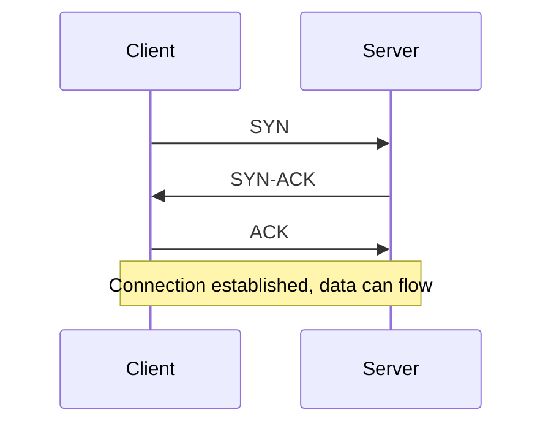
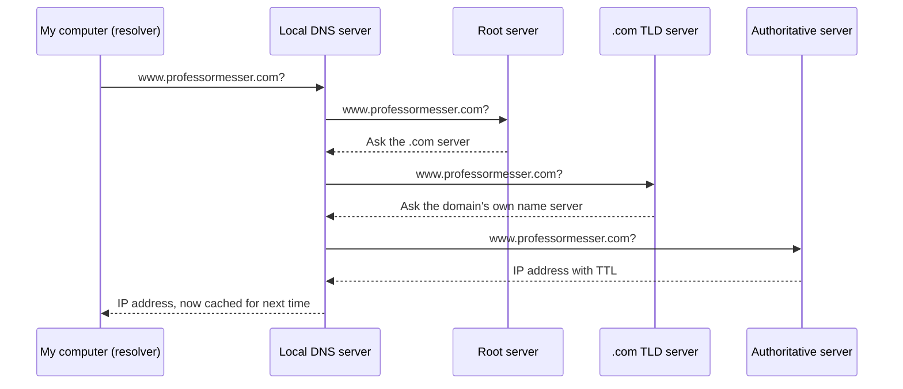

# Week 4: Network Fundamentals

**Part of my 90-day cybersecurity challenge** | Week 4 (27 Oct - 2 Nov 2026) | Lane: Blue team / DFIR

This week I stopped only running labs and built the networking theory underneath them. I covered the OSI model, network devices, IP, TCP and UDP, common ports and DNS, and tied each one back to the machines I had already completed on Hack The Box. I studied using Professor Messer's free Network+ (N10-009) course, wrote notes by hand, and tested myself from memory.

---

## Contents

1. [Why this matters for blue team work](#1-why-this-matters-for-blue-team-work)
2. [The OSI model](#2-the-osi-model)
3. [Network devices](#3-network-devices)
4. [IP, TCP, UDP and ICMP](#4-ip-tcp-udp-and-icmp)
5. [Common ports](#5-common-ports)
6. [DNS](#6-dns)
7. [Connecting the theory to my labs](#7-connecting-the-theory-to-my-labs)
8. [Security takeaways](#8-security-takeaways)
9. [Self-check](#9-self-check)
10. [Key terms](#10-key-terms)
11. [Next steps](#11-next-steps)
12. [Resources](#12-resources)

---

## 1. Why this matters for blue team work

A SOC analyst spends the day reading evidence of network activity: firewall logs, DNS queries, connection attempts, packet captures. None of that makes sense without knowing:

- **where** in the network something happened (the OSI layer),
- **what** device recorded it (switch, router, firewall),
- **which service** it was aimed at (the port),
- **how** the name or address was resolved (DNS).

This week's material is the vocabulary for reading that evidence.

---

## 2. The OSI model

The **Open Systems Interconnection (OSI) reference model** is a guide, not a protocol suite. IT professionals use it as a common language to describe where in the network something is happening, from the top layer down to the wire.

| # | Layer | What lives here | Data unit |
|---|-------|-----------------|-----------|
| 7 | Application | What the user sees: HTTP, DNS, FTP | Data |
| 6 | Presentation | Encryption (SSL/TLS), character encoding, compression | Data |
| 5 | Session | Control protocols, tunneling protocols | Data |
| 4 | Transport | TCP segments, UDP datagrams, ports | Segment / datagram |
| 3 | Network | IP addresses, routers | Packet |
| 2 | Data link | MAC addresses, EUI, switches | Frame |
| 1 | Physical | Cables, fiber, the signal itself | Bits |

**Memory aid (bottom to top):** *Please Do Not Throw Sausage Pizza Away*

**Why it is useful:** when an analyst says "this is a layer 3 problem" or "the attack happened at layer 7", they are narrowing down where to investigate. Tools like Wireshark also show captured traffic layer by layer.

---

## 3. Network devices

| Device | OSI layer | Uses | What it does |
|--------|-----------|------|--------------|
| **Switch** | 2 (Data link) | MAC addresses | Forwards **frames** to the right port inside a local network |
| **Router** | 3 (Network) | IP addresses | Connects **different networks** and forwards **packets** between them |
| **Firewall** | Mainly 3 to 4, and higher for advanced types | IPs, ports, protocols | **Allows or blocks traffic based on rules** |
| **Access point** | 2 (Data link) | MAC addresses | Connects wireless devices to the wired network |

**A common mix-up I corrected:** a firewall does **not** encrypt traffic. It filters it by rules. Encryption is done by protocols such as TLS and by VPNs.

**Why analysts care about firewall logs:** they record which connections were allowed or blocked, from which IP addresses, to which ports. A single IP hitting many different ports in a short time looks like a port scan, which is exactly what a tool like nmap produces.

---

## 4. IP, TCP, UDP and ICMP

### IP (Internet Protocol)
- Moves **packets** between hosts across networks using IP addresses (layer 3).
- It is **connectionless and best-effort**: it does not guarantee delivery or order. Other protocols handle that on top of it.
- The IP header has a **TTL** (a hop limit, which stops packets looping forever). This is a different thing from the DNS TTL in section 6.

### TCP vs UDP (layer 4)

| | **TCP** | **UDP** |
|---|---------|---------|
| Connection | Connection-oriented | Connectionless |
| Reliability | Reliable: ordered, resends lost data | No guarantee |
| Speed | Slower (more overhead) | Faster (less overhead) |
| Setup | Three-way handshake | None |
| Typical uses | Web, FTP, SSH, email | DNS queries, DHCP, streaming, voice |

**TCP three-way handshake:**

### ICMP
Carries error and test messages between devices. `ping` uses it.

### Ports and sockets
A **port** (0 to 65535) tells the computer which application should receive the traffic.

| Range | Name |
|-------|------|
| 0 - 1023 | Well-known ports |
| 1024 - 49151 | Registered ports |
| 49152 - 65535 | Dynamic ports (chosen randomly for outgoing connections) |

A **socket** is an IP address plus a port, for example `10.0.0.5:21`.

---

## 5. Common ports

| Port | Service | Protocol | Notes |
|------|---------|----------|-------|
| 20 / 21 | FTP | TCP | File transfer, **plaintext** |
| 22 | SSH / SFTP | TCP | Encrypted remote login |
| 23 | Telnet | TCP | Remote login, **plaintext** |
| 25 | SMTP | TCP | Sending email between servers |
| 53 | DNS | UDP (TCP for large replies) | Name to IP lookups |
| 67 / 68 | DHCP | UDP | Hands out IP addresses |
| 69 | TFTP | UDP | Simple file transfer |
| 80 | HTTP | TCP | Web traffic, **plaintext** |
| 110 / 143 | POP3 / IMAP | TCP | Reading email |
| 123 | NTP | UDP | Time synchronization |
| 161 / 162 | SNMP | UDP | Device monitoring |
| 389 / 636 | LDAP / LDAPS | TCP | Directory services (636 is encrypted) |
| 443 | HTTPS | TCP | Web traffic, **encrypted** |
| 445 | SMB | TCP | Windows file sharing |
| 514 | Syslog | UDP | Log forwarding to a log server or SIEM |
| 587 / 993 / 995 | Secure email | TCP | SMTP submission, IMAPS, POP3S |
| 1433 / 3306 | MS SQL / MySQL | TCP | Databases |
| 3389 | RDP | TCP | Windows remote desktop |
| 6379 | Redis | TCP | In-memory database (met in a lab) |

**Pattern worth remembering:** many protocols come in a plaintext and an encrypted pair (Telnet and SSH, HTTP and HTTPS, LDAP and LDAPS). In security work the plaintext one is the weaker choice.

---

## 6. DNS

**DNS (Domain Name System)** translates names into IP addresses, because a browser cannot connect to `www.professormesser.com` without an IP address.

### Structure
- A hierarchy: **root** (a single dot), then the **top-level domain** (.com, .org, .net, or country codes like .us and .uk), then the domain, then the host.
- The full name is a **Fully Qualified Domain Name (FQDN)**.
- The root is made up of 13 server clusters, which together contain over 1,000 actual servers.

### Servers
- **Primary DNS server:** holds the zone information. All changes are made here.
- **Secondary DNS server:** a read-only copy updated from the primary. Having both keeps DNS available if one fails.
- **Authoritative server:** the official source for a zone.
- **Non-authoritative answer:** comes from a server that looked it up elsewhere or from a cache, so it can be outdated until its TTL runs out.

### Lookups and tools
- **Forward lookup:** name to IP.
- **Reverse lookup:** IP to name (`dig -x <ip>`). The name returned can differ from the one used in the forward lookup.
- Tools: **`dig`** and **`nslookup`**.
- **Hosts file:** a local text file that overrides DNS on that machine (on Windows: `windows/system32/drivers/etc/hosts`). Some applications ignore it.

### TTL (time to live)
The number of seconds a non-authoritative server may cache an answer. In the video's example it was **300**, so an answer is at most 5 minutes old.

### How a recursive lookup works

The end user never sees these steps. The local DNS server does the work, then caches the answer so later requests are fast.

### DNS security

| Problem or fix | What it means |
|----------------|---------------|
| **Sent in the clear** | Anyone monitoring can see which names you look up |
| **Not authenticated** | You cannot be sure a response is genuine, so spoofed responses are possible |
| **DNSSEC** | Responses are digitally signed, proving where they came from and that they were not altered. Still readable by anyone capturing it |
| **DoT (DNS over TLS)** | Encrypts DNS, using **TCP 853** |
| **DoH (DNS over HTTPS)** | Encrypts DNS inside normal HTTPS, using **TCP 443**. Many modern browsers use it by default |

---

## 7. Connecting the theory to my labs

| Lab | Service | Port | What the theory explains |
|-----|---------|------|--------------------------|
| **Meow** | Telnet | TCP 23 | Plaintext remote login. Anyone capturing the traffic could read it, which is why SSH replaced Telnet |
| **Fawn** | FTP | TCP 21 | Plaintext file transfer. A layer 7 service running over TCP at layer 4 |
| **Redeemer** | Redis | TCP 6379 | A database exposed to the network with no authentication, so anyone could connect and read it |

In all three, the first step was finding the open port with a scan. That is a **layer 4** discovery: the scan looks at which ports answer. Once I knew the port, I knew the service, and the service told me how to interact with it.

---

## 8. Security takeaways

1. **Plaintext protocols expose their contents.** Telnet, FTP and HTTP can be read by anyone who captures the traffic. Prefer SSH, SFTP and HTTPS.
2. **Exposed services are an easy target.** Redeemer showed that a database reachable with no password is a complete failure of access control, however simple the service is.
3. **Ports that attackers commonly target:** 22 (SSH), 23 (Telnet), 445 (SMB) and 3389 (RDP). Many failed attempts against one of these in a log is a red flag.
4. **Logs are the analyst's evidence.** Firewalls, routers, switches and servers produce them, and Syslog (UDP 514) is how many devices forward them to a central place.
5. **DNS tells a story.** The domains a machine looks up can reveal malware contacting its controller. DoH can hide that traffic from network monitoring, so it matters which DNS path an organization allows.
6. **A tampered hosts file or spoofed DNS response can redirect a victim** to the wrong server without them noticing.

---

## 9. Self-check

I answered these from memory after studying.

**Which OSI layer does a switch work at, and what address does it use?**
Layer 2 (data link), using MAC addresses.

**Which layer does a router work at, and what does it connect?**
Layer 3 (network), connecting different networks using IP addresses.

**What does a firewall do?**
It allows or blocks traffic based on rules such as IP, port and protocol. It does not encrypt.

**What is the difference between authoritative and non-authoritative DNS answers?**
An authoritative answer comes directly from a server that hosts the domain's official records. A non-authoritative answer comes from a resolver that looked it up elsewhere and may be cached.

**In what order does a local DNS server ask in a recursive query?**
Root server, then the TLD server (.com), then the domain's authoritative server.

**Which ports do DoT and DoH use?**
DoT uses TCP 853. DoH uses TCP 443.

---

## 10. Key terms

| Term | Meaning |
|------|---------|
| **OSI model** | Seven-layer reference model for describing network communication |
| **Frame / packet / segment** | Data units at layers 2, 3 and 4 |
| **MAC address** | Hardware address used on a local network (layer 2) |
| **IP address** | Logical address used to route traffic between networks (layer 3) |
| **Port** | Number identifying the application that should receive traffic |
| **Socket** | IP address plus port |
| **TCP / UDP** | Reliable connection-oriented vs fast connectionless transport |
| **Three-way handshake** | SYN, SYN-ACK, ACK: how TCP opens a connection |
| **ICMP** | Protocol for error and test messages, used by `ping` |
| **Firewall** | Device or software that allows or blocks traffic by rules |
| **DNS** | System that translates names into IP addresses |
| **FQDN** | Fully qualified domain name, the complete name of a host |
| **TTL (DNS)** | How long, in seconds, a cached DNS answer may be kept |
| **Authoritative server** | The official source of DNS records for a zone |
| **Recursive query** | A DNS server working through root, TLD and authoritative servers on the client's behalf |
| **DNSSEC / DoT / DoH** | Signing DNS responses / encrypting DNS over TLS / encrypting DNS over HTTPS |
| **Syslog** | Standard for forwarding log messages to a central server |

---

## 11. Next steps

- **Wireshark capture (planned next):** capture my own traffic in a virtual lab and identify a DNS query and response, an HTTP request and a TCP three-way handshake, then write it up as a separate report.
- **Logs and Monitoring:** study how Syslog, protocol analysis and SIEMs work, ahead of the SIEM lab in the next phase.
- **Linux fundamentals:** command line, permissions and services.
- **Phase 2 of the plan:** blue team labs, a free SIEM lab, and forensics practice.

---

## 12. Resources

- [Professor Messer's N10-009 Network+ Training Course](https://www.professormesser.com/network-plus/n10-009/n10-009-video/n10-009-training-course/) (free)
  - [Understanding the OSI Model](https://www.professormesser.com/network-plus/n10-009/n10-009-video/understanding-the-osi-model-n10-009/)
  - [Networking Devices](https://www.professormesser.com/network-plus/n10-009/n10-009-video/networking-devices-n10-009/)
  - [Introduction to IP](https://www.professormesser.com/network-plus/n10-009/n10-009-video/introduction-to-ip-n10-009/)
  - [Common Ports](https://www.professormesser.com/network-plus/n10-009/n10-009-video/common-ports-n10-009/)
  - [An Overview of DNS](https://www.professormesser.com/network-plus/n10-009/n10-009-video/an-overview-of-dns-n10-009/)
- Hack The Box Starting Point: Meow, Fawn, Redeemer
